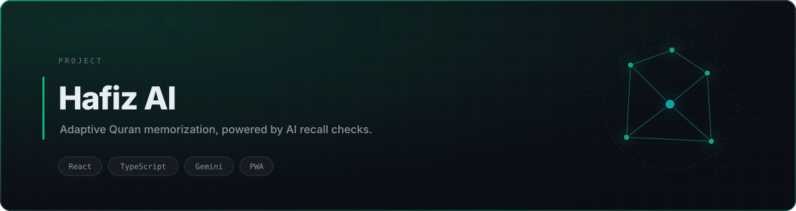
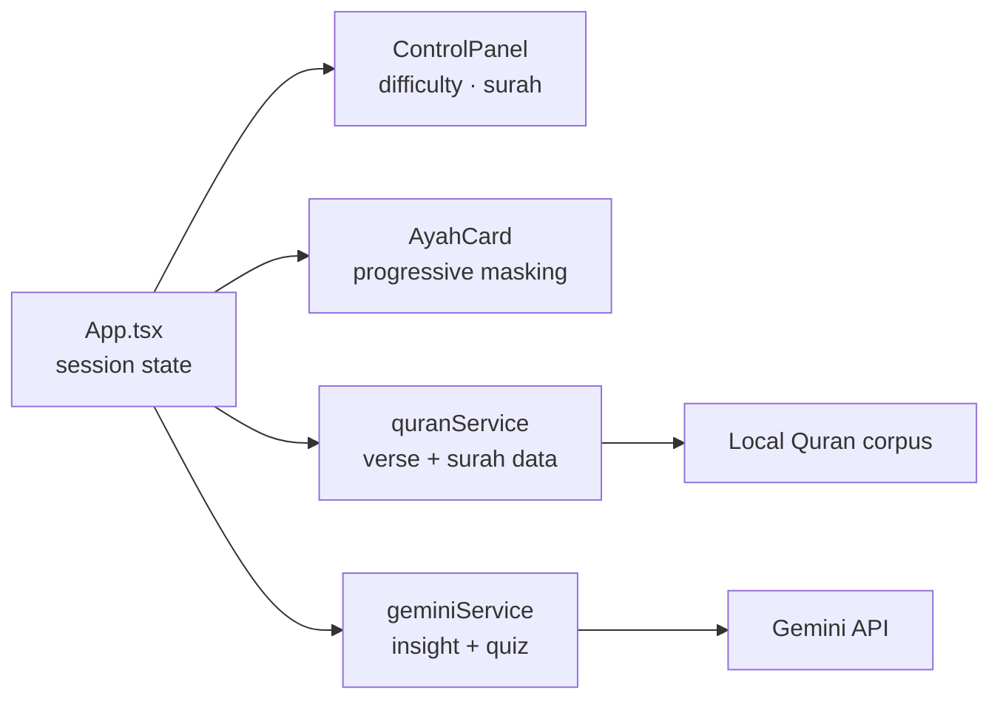

<div align="center">

<picture>
  <source media="(prefers-color-scheme: dark)" srcset="./assets/banner-dark.svg">
  <source media="(prefers-color-scheme: light)" srcset="./assets/banner-light.svg">
  
</picture>

<br>


<br><br>

<a href="https://hafizai.vercel.app"><b>Live Demo</b></a> · <a href="#quick-start">Quick Start</a> · <a href="#architecture">Architecture</a>

</div>

## Overview

Most memorization apps are flashcards with a Quran skin: they show a verse, you tap to reveal, you move on. That tests recognition at best.

**Hafiz AI** models the two things that actually break memorization — *fading recall* and *memorizing without understanding*. Verses hide progressively based on how you've performed, and the model probes meaning with generated comprehension questions instead of only asking you to repeat text.

Mic input makes recitation practice hands-on rather than silent reading.

## Key Features

| | |
|---|---|
| **Progressive verse hiding** | Words are masked in stages, so each session starts from the strongest cue and degrades toward free recall |
| **AI comprehension checks** | Gemini generates tafsir-grounded questions that test understanding, not transcription |
| **Recitation practice** | Microphone capture lets you recite aloud instead of reading silently |
| **Surah-aware context** | Tafsir and keyword extraction are scoped to the surah being studied, so feedback stays relevant |
| **Installable** | Ships a manifest and icons, so it runs as a PWA on mobile |

## Architecture



`App.tsx` owns session state. `components/` is presentational. `services/` is the only place that talks to the network — `geminiService` is the single Gemini boundary, and `quranService` isolates scripture data so a corpus change never touches UI code.

## Project Structure

```text
.
├── App.tsx                 # session orchestration
├── components/
│   ├── AyahCard.tsx        # verse rendering + progressive masking
│   └── ControlPanel.tsx    # surah and difficulty controls
├── services/
│   ├── geminiService.ts    # Gemini boundary (insight, quiz generation)
│   └── quranService.ts     # verse retrieval
├── types.ts                # shared contracts
└── vite.config.ts          # env injection for GEMINI_API_KEY
```

## Quick Start

```bash
git clone https://github.com/tribetorkoz/hafiz-ai.git
cd hafiz-ai
npm install
cp .env.example .env      # add your GEMINI_API_KEY
npm run dev               # http://localhost:3000
```

<details>
<summary><b>Environment variables</b></summary>

| Variable | Required | Purpose |
|---|---|---|
| `GEMINI_API_KEY` | Yes | Powers tafsir insight and comprehension questions. Get one at [aistudio.google.com/apikey](https://aistudio.google.com/apikey) |

`vite.config.ts` injects this into the client as `process.env.GEMINI_API_KEY`. Nothing else is required.
</details>

<details>
<summary><b>Build for production</b></summary>

```bash
npm run build     # emits dist/
npm run preview   # serve the build locally
```
</details>

## Security Note

The API key is read from the environment and is **never** committed. If you fork this, use your own key — keys embedded in client bundles are visible to anyone who opens devtools, so restrict yours by HTTP referrer in Google Cloud Console.

## License

MIT
